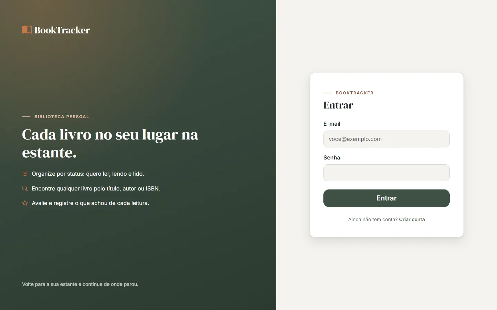
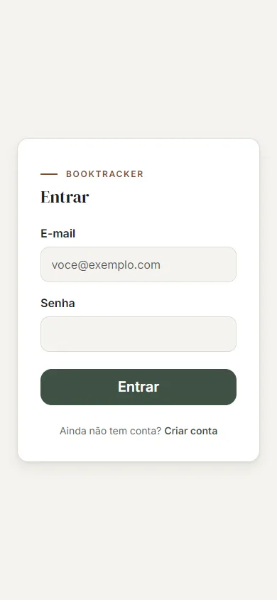
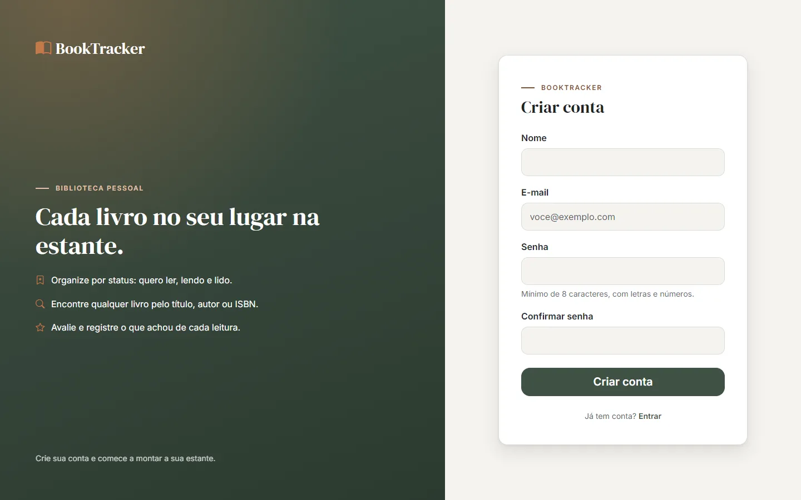
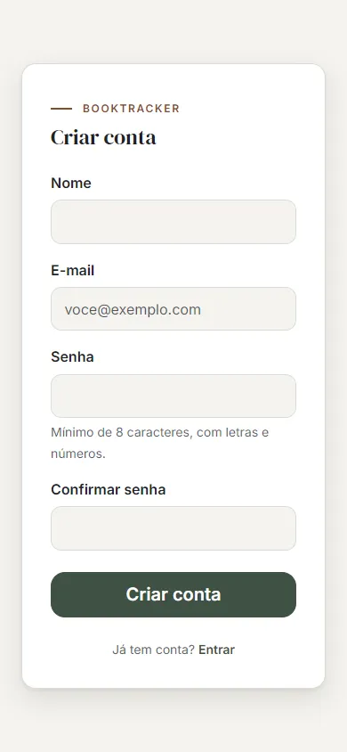
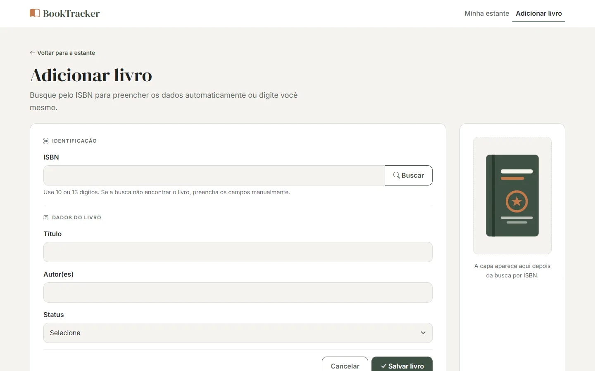
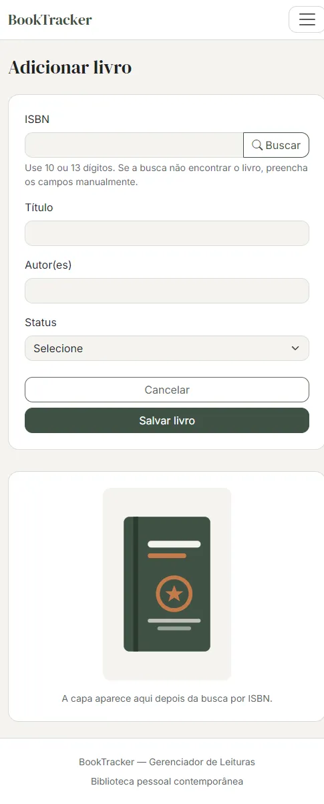
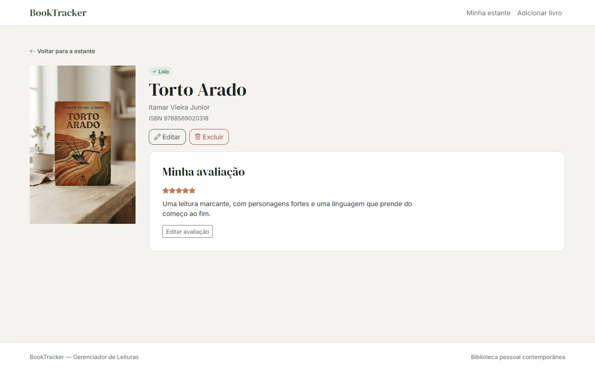
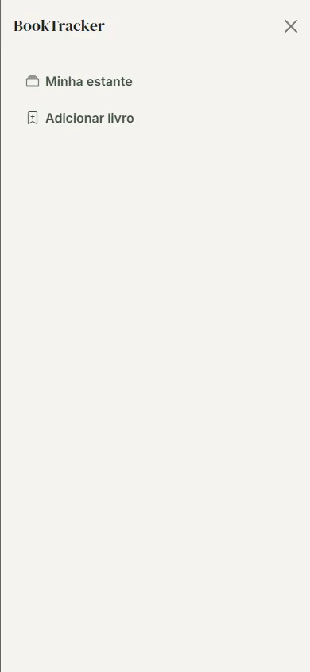
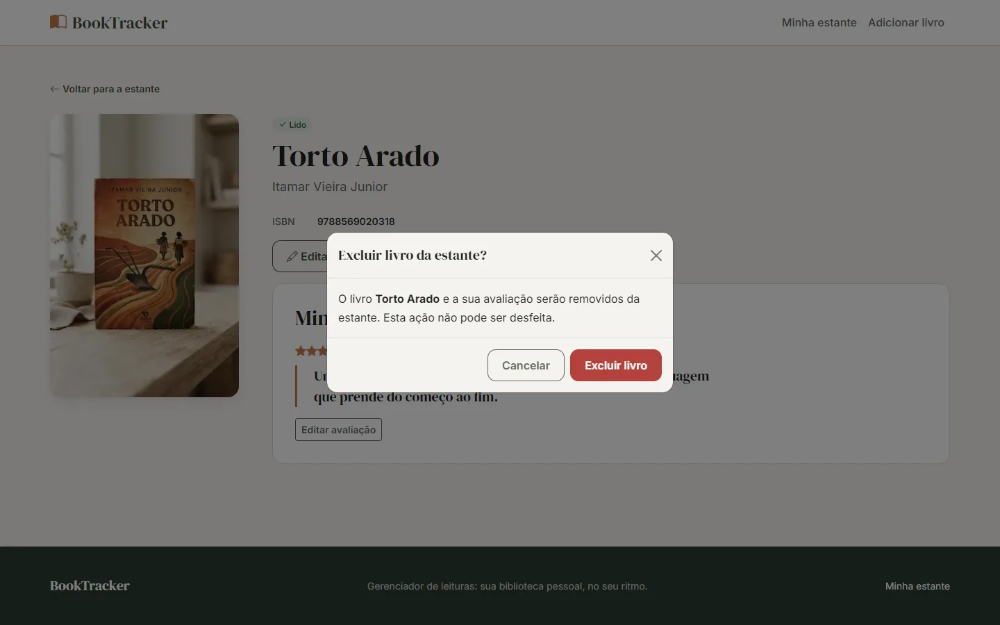

# BookTracker — Gerenciador de Leituras

**Autor:** Isaque Cordeiro
**Disciplina:** Desenvolvimento de Páginas Web com Framework e CSS (TSI32B) — UTFPR, Sistemas para Internet

## Descrição

Aplicação web responsiva para organizar uma biblioteca pessoal: criar uma conta acadêmica de demonstração, cadastrar livros e acompanhar cada um por status de leitura (Quero ler, Lendo, Lido), buscar dados por ISBN e avaliar obras concluídas.

**Estado atual: Entrega 2 — a casca.** As cinco páginas já existem em HTML, Sass e Bootstrap, com layout responsivo. Ainda não há lógica JavaScript, validação, dados nem API: isso é a Entrega 3.

## Links

- **Protótipo (Google Stitch):** https://stitch.google.com/u/1/projects/18205289966603005290?pli=1
- **Design System:** [docs/design-system.md](docs/design-system.md)
- **Site em produção:** a partir da Entrega 3
- **Vídeos:** os links do Vídeo 1 e do Vídeo 2 são entregues no Moodle; o Vídeo 3 é da Entrega 3

## Tecnologias

| Tecnologia | Uso |
|---|---|
| **Bootstrap 5.3** | Framework CSS (Grid, Flexbox e componentes). Tailwind não é usado. |
| **Sass (SCSS)** | Tokens do Design System, mixins, funções e customização do Bootstrap. |
| Bootstrap Icons | Ícones. |
| Google Books API v1 | API pública para buscar título, autoria e capa por ISBN (Entrega 3). |
| JSON Server | API fake para usuários, livros e avaliações (Entrega 3). |
| jQuery, uuid | Dependências instaladas para as próximas entregas. |

## Páginas

| Página | Arquivo |
|---|---|
| Login | `login.html` |
| Cadastro | `cadastro.html` |
| Minha estante | `index.html` |
| Adicionar/Editar livro | `livro-form.html` |
| Detalhes do livro | `livro.html` |

## Organização do projeto

```
assets/
  scss/        main.scss + parciais: _functions, _variables, _mixins, _base, _components, _paginas
  css/         main.css (gerado pelo Sass e versionado, como pede a Entrega 2)
  images/      capas em JPG e WebP e a ilustração de capa
docs/          prd, architecture, spec, design-brief, design-system, course-roadmap e as capturas em telas/
index.html, login.html, cadastro.html, livro-form.html, livro.html   as cinco páginas
package.json   dependências (Bootstrap, Bootstrap Icons, Sass...) e scripts do Sass
.gitignore     node_modules/, .env, logs e arquivos de editor
```

## Instruções de execução

```bash
git clone https://github.com/isaquecordeiro9856/gerenciador-de-leituras.git
cd gerenciador-de-leituras
npm install
```

Abra a pasta no VS Code e abra o `index.html` com a extensão **Live Server**.

Para alterar os estilos, edite os arquivos em `assets/scss/` e recompile:

```bash
npm run build:css    # compila uma vez
npm run watch:css    # recompila ao salvar
```

O `assets/css/main.css` já vem compilado no repositório.

## Telas da aplicação

Capturas reais. Desktop: janela de 1440 × 900 (área visível). Celular: largura de 390 px (algumas mostram a página inteira, por isso são mais altas).

| Página | Desktop | Celular |
|---|---|---|
| Login |  |  |
| Cadastro |  |  |
| Minha estante |  |  |
| Adicionar livro |  |  |
| Detalhes |  |  |

Componentes do Bootstrap com JavaScript em uso:

| Componente | Desktop | Celular |
|---|---|---|
| Offcanvas (menu) | — (a navbar fica aberta) |  |
| Modal (excluir livro) |  |  |

Também há capturas em 768 × 1024 (`docs/telas/tablet-*.webp`).

## ✅ Checklist | Indicadores de Desempenho

### RA1 — Utilizar Frameworks CSS para estilização de elementos HTML e criação de layouts responsivos

- [x] ID 01 — Prototipa interfaces adaptáveis para no mínimo os tamanhos de tela mobile e desktop, usando ferramentas de design tradicionais (Figma, Quant UX ou Sketch) ou IA (Stitch).
- [x] ID 02 — Implementa layout responsivo com Framework CSS (Bootstrap, Materialize) usando Flexbox ou Grid do próprio framework.
- [x] ID 03 — Implementa layout responsivo com CSS puro, usando Flexbox ou Grid Layout.
- [x] ID 04 — Utiliza componentes prontos de um Framework CSS (ex.: card, button) e componentes JavaScript do framework (ex.: modal, carousel).
- [x] ID 05 — Cria layout fluido usando unidades relativas (vw, vh, %, em, rem) no lugar de unidades fixas (px).
- [x] ID 06 — Aplica um Design System consistente (cores, tipografia, padrões de componentes) em toda a aplicação.
- [x] ID 07 — Utiliza Sass (SCSS) com ou sem framework, aplicando variáveis, mixins e funções para modularizar o código.
- [x] ID 08 — Aplica tipografia responsiva (media queries mobile first) ou tipografia fluida (função clamp() + unidades relativas).
- [x] ID 09 — Aplica técnicas de responsividade de imagens usando CSS (object-fit, containers com unidades relativas).
- [x] ID 10 — Otimiza imagens usando formatos modernos (WebP) e carregamento adaptativo (srcset, picture, ou parâmetros do Cloudinary).

### RA2 — Realizar tratamento de formulários e aplicar validações customizadas no lado cliente

- [ ] ID 11 — Implementa validação HTML nativa (campos obrigatórios, tipos, limites de caracteres) com mensagens de erro/sucesso no lado cliente.
- [ ] ID 12 — Aplica expressões regulares (REGEX) para validações customizadas (e-mail, telefone, datas, etc.)
- [ ] ID 13 — Utiliza elementos de seleção em formulários (checkbox, radio, select) para coleta de dados.
- [ ] ID 14 — Implementa leitura e escrita no Web Storage (localStorage/sessionStorage) para persistir dados localmente.

### RA3 — Aplicar ferramentas para otimização do processo de desenvolvimento web

- [x] ID 15 — Configura ambiente com Node.js e NPM para gerenciamento de pacotes e dependências.
- [x] ID 16 — Utiliza boas práticas de versionamento no Git/GitHub (branch main ou branches específicos, uso de .gitignore).
- [ ] ID 17 — Mantém um README.md padronizado, conforme template da disciplina, com checklist preenchido.
- [ ] ID 18 — Organiza arquivos do projeto de forma modular, seguindo padrão de exemplo fornecido.
- [ ] ID 19 — Configura linters e formatadores (ESLint, Prettier) para manter qualidade e padronização do código.

### RA4 — Aplicar bibliotecas de funções e componentes em JavaScript para aprimorar a interatividade de páginas web

- [ ] ID 20 — Utiliza jQuery para manipulação do DOM e interatividade (eventos, animações, manipulação de elementos)
- [ ] ID 21 — Integra e configura um plugin jQuery relevante (ex.: jQuery Mask Plugin) ou outra biblioteca de funções.

### RA5 — Efetuar requisições assíncronas para uma API fake e APIs públicas, permitindo a obtenção e manipulação de dados dinamicamente

- [ ] ID 22 — Realiza requisições assíncronas para uma API fake (ex.: JSON Server) para persistir dados de um formulário.
- [ ] ID 23 — Realiza requisições assíncronas para uma API fake para exibir dados na página.
- [ ] ID 24 — Realiza requisições assíncronas para APIs públicas reais (OpenWeather, ViaCEP etc.), exibindo os dados e tratando erros.

## 📚 Documentação

- [PRD](docs/prd.md) — escopo, público-alvo, histórias de usuário e regras de negócio.
- [Architecture](docs/architecture.md) — modelo de dados, Design System, responsividade e arquitetura.
- [Spec](docs/spec.md) — contratos técnicos, validações, integrações e convenções.
- [Design Brief](docs/design-brief.md) — contrato visual e inventário do protótipo.
- [Design System](docs/design-system.md) — paleta, tipografia, componentes e como os tokens viram código.
- [Roadmap da disciplina](docs/course-roadmap.md) — planejamento do semestre.

## Regras de produto

- **Adicionar e Editar** usam o mesmo formulário (`livro-form.html`), em dois modos.
- **Avaliação** (1 a 5 estrelas e resenha) existe só nos Detalhes e só para livros com status Lido.
- **Autenticação** é acadêmica, apenas de demonstração, sobre JSON Server. Use somente credenciais fictícias e nunca guarde senha no Web Storage.
